

  

  &nbsp;
  <a href="https://www.linkedin.com/in/abousmah">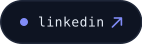</a>&nbsp;
  <a href="mailto:amine.bousmah1@gmail.com">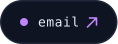</a>

 

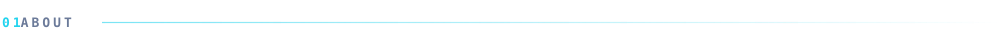

  

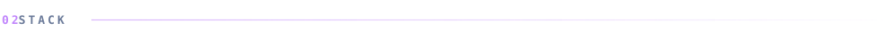
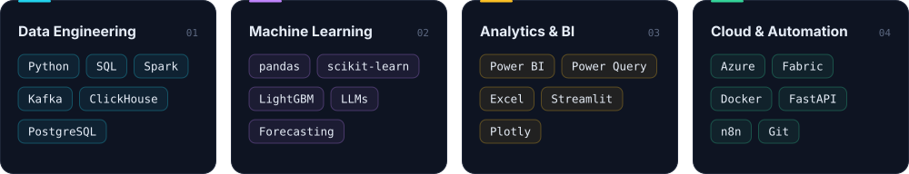

  

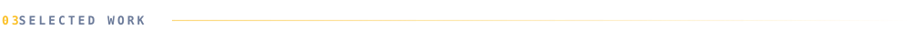

  <a href="https://github.com/Aminebousmah/OpenLakehouse">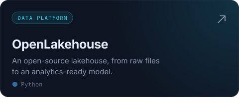</a>
  <a href="https://github.com/Aminebousmah/VeliStream">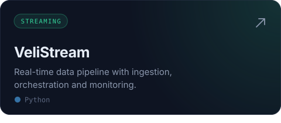</a>
  <a href="https://github.com/Aminebousmah/HotelForecast">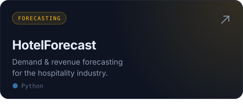</a>
  <a href="https://github.com/Aminebousmah/NoShow">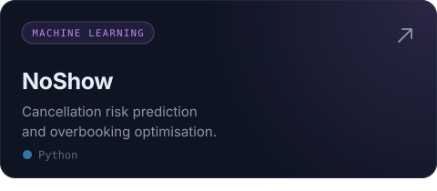</a>
  <a href="https://github.com/Aminebousmah/AutoFacture">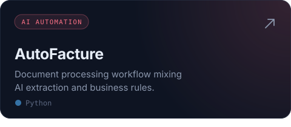</a>
  <a href="https://github.com/Aminebousmah/Eleven-Fields">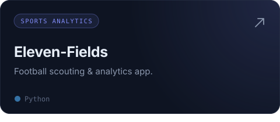</a>

  
    more projects &nbsp;→&nbsp;
    <a href="https://github.com/Aminebousmah/Matchscape">Matchscape</a> &nbsp;·&nbsp;
    <a href="https://github.com/Aminebousmah/Tribara">Tribara</a> &nbsp;·&nbsp;
    <a href="https://github.com/Aminebousmah/HowDrawaBox">HowDrawaBox</a>
  

 

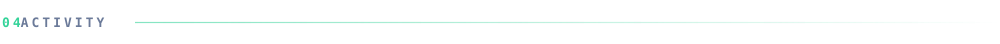

<picture>
  <source media="(prefers-color-scheme: dark)" srcset="https://raw.githubusercontent.com/Aminebousmah/Aminebousmah/output/snake-dark.svg" />
  <source media="(prefers-color-scheme: light)" srcset="https://raw.githubusercontent.com/Aminebousmah/Aminebousmah/output/snake-light.svg" />
  
</picture>

<!-- Assets are generated by scripts/build_assets.py — edit the text there, then re-run it. -->
